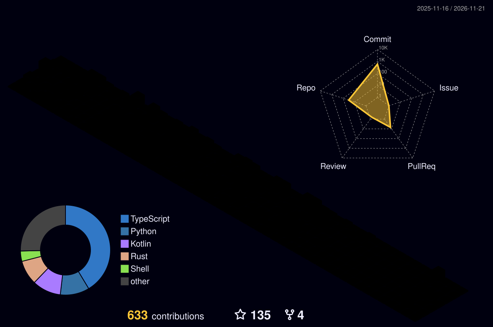

<h1 align="center">Ranto</h1>

  Full-Stack Developer · AI Integration Engineer 🇲🇬

  <a href="https://ranto-dev.vercel.app">Portfolio</a> ·
  <a href="https://linkedin.com/in/aina-iarindrano">LinkedIn</a> ·
  <a href="mailto:rantoandrianandraina@gmail.com">Email</a>

---

### Projets en cours

| Projet | Description | Stack |
| --- | --- | --- |
| [**FlowOps**](https://github.com/ranto-dev/FlowOps) | Plateforme low-code CI/CD pour créer, déployer et monitorer des workflows GitHub Actions | Python, FastAPI, MLflow, React, Docker |
| [**Kilalao**](https://github.com/ranto-dev/Kilalao) | Application d'apprentissage interactive et ludique | TypeScript, React |

### Stack

  

### Activité

